# Лабораторная работа №2

**Выполнил:** Палкина Агата

**Группа:** ЛА-3

**Вариант:** 8 (задачи 1.3, 1.5, 2.4, 3.4, 4.5, 5.5)

---

## Задание 1.3. Имена

**Текст задачи.**
Создайте сущность Имя, которая описывается тремя параметрами: Фамилия, Личное
имя, Отчество. Имя может быть приведено к строковому виду, включающему
традиционное представление всех трех параметров: Фамилия Имя Отчество
(например «Иванов Иван Иванович»). Необходимо предусмотреть возможность того,
что какой-либо из параметров может быть не задан, и в этом случае он не учитывается
при приведении к текстовому виду.

**Реализация.**

Класс `Name` описывает сущность «Имя».

**Приватные поля.** В классе объявлены три приватных поля типа `string`:
- `_surname` — хранит фамилию. Может быть `null`, если фамилия не задана.
- `_personalName` — хранит личное имя. Может быть `null`, если имя не задано.
- `_patronymic` — хранит отчество. Может быть `null`, если отчество не задано.

Модификатор `private` означает, что доступ к этим полям возможен только внутри
класса `Name`. Это реализует принцип инкапсуляции: внешний код не может напрямую
изменить состояние объекта, он должен использовать свойства.

**Конструктор.** В классе есть публичный конструктор `Name(string surname, string
personalName, string patronymic)`. Конструктор принимает три параметра типа `string` и
присваивает их значения соответствующим приватным полям. Любой из параметров
может быть `null` — в этом случае соответствующее поле тоже будет `null`, и при
выводе эта часть имени будет пропущена.

**Свойства.** В классе определены три публичных свойства: `Surname`,
`PersonalName`, `Patronymic`. Каждое свойство реализовано как полное — с методами
доступа `get` и `set`. Метод `get` возвращает значение соответствующего приватного
поля, метод `set` устанавливает новое значение. Автосвойства не используются, как
требует задание. Свойства обеспечивают контролируемый доступ к полям: внешний
код может читать и изменять значения только через них.

**Метод `ToString()`.** Переопределён стандартный метод `Object.ToString()`. Метод
возвращает текстовое представление имени в формате «Фамилия Имя Отчество»,
пропуская незаданные части. Сначала создаётся пустая строка для накопления
результата. Затем по очереди проверяется каждое поле: если строка не является `null`,
не пустая и не состоит из пробелов, соответствующая часть добавляется к результату
вместе с пробелом. Проверка выполняется с помощью метода `IsNullOrWhiteSpace`,
который возвращает `true` для `null`, пустой строки и строки из одних пробелов. В
самом конце вызывается `TrimEnd()`, который удаляет возможный лишний пробел в
конце строки.

**Что демонстрирует задача.** Инкапсуляцию (три приватных поля, доступ через
свойства), работу с `null` (параметры могут быть не заданы), переопределение метода
`ToString()` для предоставления текстового представления объекта.

**Тестирование.**

Корректный ввод (все три параметра — имя, фамилия, отчество):

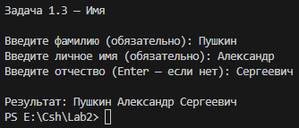

Корректный ввод (без отчества):

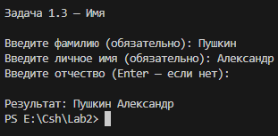

Некорректный ввод (пустое значение — программа переспрашивает ввод):

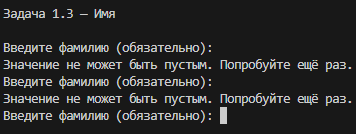

---

## Задание 1.5. Дом

**Текст задачи.**
Создайте сущность Дом, которая описывается количеством этажей в виде числа. У
Дома можно запросить текстовую форму, которое имеет представление вида «дом с N
этажами», где N это число. Гарантировать правильное окончание фразы, в
зависимости от количества этажей.

**Реализация.**

Класс `House` описывает сущность «Дом».
**Приватное поле.** В классе объявлено одно приватное поле `_floors` типа `int`. Оно
хранит количество этажей. Модификатор `private` закрывает прямой доступ к полю
извне.

**Конструктор.** В классе есть публичный конструктор `House(int floors)`. Он принимает
одно целое число — количество этажей — и присваивает его приватному полю.
**Свойство.** В классе определено публичное свойство `Floors` типа `int`. Реализовано
как полное: `get` возвращает значение поля `_floors`, `set` устанавливает новое.
Автосвойство не используется.

**Метод `ToString()`.** Переопределён стандартный метод. Он возвращает строку вида
«дом с N этажами», где вместо N подставляется количество этажей. Слово «этаж»
склоняется в зависимости от числа. Проверка: если число оканчивается на 1 и при
этом не равно 11, используется форма «этажом»; во всех остальных случаях — форма
«этажами». Условие проверяется через остатки от деления: `% 10 == 1` определяет
последнюю цифру, `% 100 != 11` отсеивает числа 11, 111, 211 и так далее. Такой подход
соответствует правилам русского языка для фразы «дом с N этажами» в творительном
падеже.

**Что демонстрирует задача.** Инкапсуляцию (приватное поле, доступ через свойство),
работу с числовыми типами и остатками от деления, переопределение `ToString()`.

**Тестирование.**

Корректный ввод (N = 5):

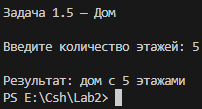

Корректный ввод (N = 1 — другая форма слова):

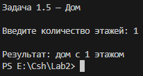

Корректный ввод (N = 23):

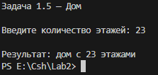

Некорректный ввод (не число и отрицательное число — программа переспрашивает):

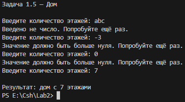

---

## Задание 2.4. Сотрудники и отделы

**Текст задачи.**
Создайте сущность Сотрудник, которая описывается именем (в строковой форме) и
отделом, в котором сотрудник работает, причем у каждого отдела есть название и
начальник, который также является Сотрудником. Сотрудник может быть приведен к
текстовой форме вида: «Имя работает в отделе Название, начальник которого Имя». В
случае если сотрудник является руководителем отдела, то текстовая форма должна
быть «Имя начальник отдела Название».

**Реализация.**

Задача решается двумя классами: `Employee` (Сотрудник) и `Department` (Отдел).

**Класс `Employee`.**

Приватные поля: `_name` типа `string` — имя сотрудника, и `_department` типа
`Department` — ссылка на отдел, в котором сотрудник работает. Модификатор `private`
закрывает прямой доступ к этим полям.

Конструктор `Employee(string name, Department department)` принимает имя и ссылку
на отдел, присваивает их приватным полям.

Публичные свойства: `Name` (тип `string`) и `Department` (тип `Department`). Оба
реализованы как полные, с `get` и `set`, без автосвойств.

Метод `ToString()` переопределён. Он определяет, является ли сотрудник начальником
своего отдела. Для этого сравнивается ссылка на начальника отдела
(`_department.Boss`) со ссылкой на сам объект (`this`). Если это один и тот же объект —
значит, сотрудник и есть начальник, и метод возвращает строку «Имя начальник отдела
Название». Если начальник ещё не назначен (`Boss == null`), выводится строка «Имя
работает в отделе Название, начальник не назначен». В остальных случаях
возвращается строка «Имя работает в отделе Название, начальник которого Имя
начальника».

**Класс `Department`.**

Приватные поля: `_name` типа `string` — название отдела, и `_boss` типа `Employee` —
ссылка на начальника.

Конструктор `Department(string name)` принимает название. Начальник
устанавливается в `null` — он назначается позже, когда уже созданы сотрудники.
Публичные свойства: `Name` (тип `string`) и `Boss` (тип `Employee`). Оба реализованы
как полные.

Метод `ToString()` возвращает строку с названием отдела и именем начальника. Если
начальник не назначен, возвращается сообщение об этом.

**Что демонстрирует задача.** Связь двух сущностей через ссылки (ассоциация).
Возможность циклической ссылки, когда объекты знают друг о друге. Сравнение
ссылок через `==`. Работу с `null` для ещё не заданных ссылок.

**Тестирование.**

Корректный ввод (отдел ИТ, начальник — сотрудник 2):

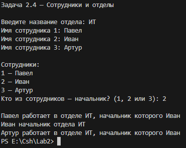

Корректный ввод (отдел Sales, начальник — сотрудник 1):

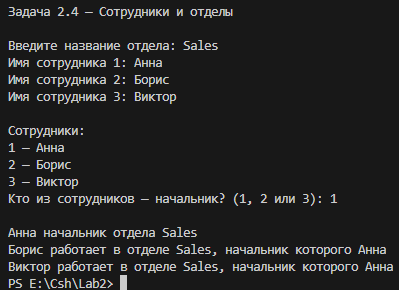

Некорректный ввод (пустые значения и неверный номер начальника — программа
переспрашивает):

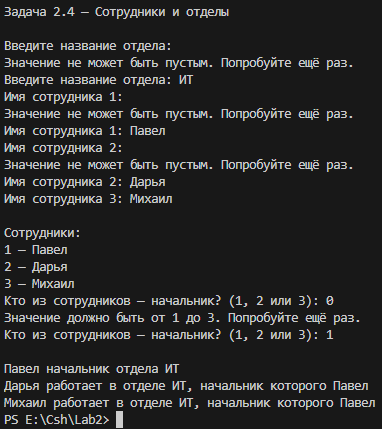

---

## Задание 3.4. Список сотрудников отдела

**Текст задачи.**
Измените решение, полученное в задаче 2.4 таким образом, чтобы имея ссылку на
сотрудника, можно было бы узнать список всех сотрудников этого отдела.

**Реализация.**

Задача является расширением задачи 2.4. Изменения затрагивают классы `Employee`
и `Department`.

**Изменения в классе `Department`.**

Добавлено приватное поле `_employees` типа `Employee[]` — массив сотрудников
отдела. В конструкторе это поле инициализируется пустым массивом. Добавлены два
публичных метода: `GetEmployees()` возвращает массив сотрудников,

`AddEmployee(Employee e)` добавляет нового сотрудника в отдел. Поскольку массив в
языке C# имеет фиксированную длину, добавление выполняется так: создаётся новый
массив на один элемент длиннее, в него копируются все старые элементы, а в
последнюю ячейку записывается новый сотрудник. После этого ссылка на массив в
поле `_employees` заменяется на новую.

**Изменения в классе `Employee`.**

В конструктор `Employee(string name, Department department)` добавлена одна строка:
`department.AddEmployee(this)`. Ключевое слово `this` — это ссылка на объект, который
сейчас создаётся. То есть каждый новый сотрудник при создании автоматически
регистрируется в своём отделе.

**Что демонстрирует задача.** Расширение класса без изменения его публичного
интерфейса. Работу с массивами фиксированной длины — их пересоздание для
добавления элемента. Использование ключевого слова `this` для передачи ссылки на
текущий объект.

**Тестирование.**

Корректный ввод (список сотрудников отдела ИТ):

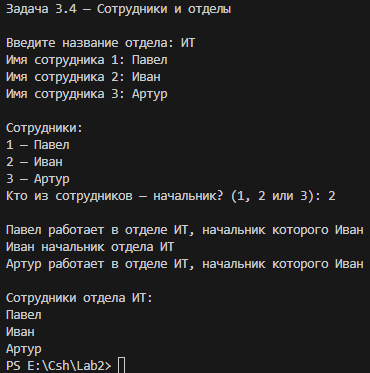

Корректный ввод (другой отдел):

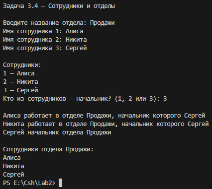

Некорректный ввод (пустые значения и неверный номер начальника — программа
переспрашивает):

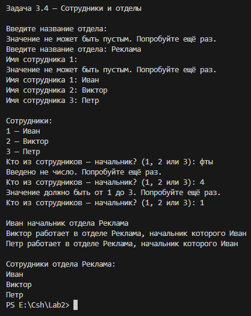

---

## Задание 4.5. Имена (конструкторы)

**Текст задачи.**
Измените сущность Имя из задачи 1.3. Новые требования включают:
- Имя можно создать указав только Личное имя
- Имя можно создать указав Личное имя и Фамилию
- Имя можно создать указав все три параметра: Личное имя, Фамилию, Отчество

**Реализация.**

Задача является расширением задачи 1.3. Изменения затрагивают класс `Name`.

**Конструкторы.** Вместо одного конструктора добавлены три перегруженных:
- `Name(string personalName)` — только личное имя. Остальные поля
инициализируются `null`.
- `Name(string personalName, string surname)` — личное имя и фамилия. Отчество
инициализируется `null`.
- `Name(string personalName, string surname, string patronymic)` — все три параметра.
Порядок параметров задан условием задачи: сначала личное имя, потом фамилия,
потом отчество. Перегрузка конструкторов позволяет создавать объект разными
способами — программисту не нужно каждый раз указывать `null` для незаданных
полей.

**Метод `ToString()`.** Изменён порядок вывода: теперь имя выводится в формате
«Имя Отчество Фамилия». Такой порядок задан примерами в условии задачи. Пропуск
незаданных частей остался тем же — каждая часть проверяется через
`IsNullOrWhiteSpace`, и лишний пробел в конце удаляется через `TrimEnd()`.

**Приватные поля и свойства** остались без изменений, как в задаче 1.3.

**Что демонстрирует задача.** Перегрузку конструкторов. Возможность создавать
объект разными способами с одним и тем же классом. Гибкость интерфейса класса.

**Тестирование.**

Корректный ввод (все три параметра):

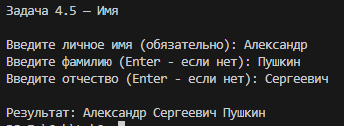

Корректный ввод (имя и фамилия, без отчества):

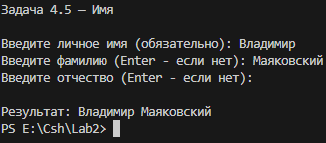

Корректный ввод (только имя):

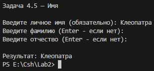

Некорректный ввод (пустое имя — программа переспрашивает):

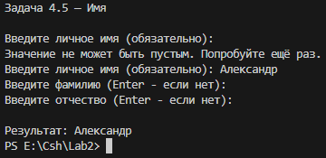

---

## Задание 5.5. Дроби

**Текст задачи.**
Создайте сущность Дробь со следующими особенностями:
- Имеет числитель: целое число
- Имеет знаменатель: целое число
- Дробь может быть создана с указанием числителя и знаменателя
- Может вернуть строковое представление вида «числитель/знаменатель»
- Может выполнять операции сложения, вычитания, умножения и деления с другой
Дробью или целым числом. Результатом операции должна быть новая Дробь (таким
образом, обе исходные дроби не изменяются)

**Реализация.**

Класс `Fraction` описывает сущность «Дробь».

**Приватные поля.** В классе объявлены два приватных поля типа `int`: `_numerator` —
числитель и `_denominator` — знаменатель. Модификатор `private` закрывает прямой
доступ извне.

**Конструктор.** `Fraction(int numerator, int denominator)` принимает числитель и
знаменатель, присваивает их полям.

**Свойства.** Публичные свойства `Numerator` и `Denominator` типа `int`. Оба
реализованы как полные — с `get` и `set`, без автосвойств.

**Метод `ToString()`.** Возвращает строку в формате «числитель/знаменатель». Просто
конкатенация значения числителя, символа «/» и значения знаменателя.

**Методы арифметики.** В классе реализованы восемь методов: `sum`, `minus`, `mul`,
`div` — по два варианта каждого. Первый вариант принимает вторую дробь (`Fraction
other`), второй — целое число (`int other`).

Каждый метод с дробью вычисляет числитель и знаменатель новой дроби по
математическим формулам:
- Для сложения числитель равен произведению первого числителя на второй
знаменатель плюс произведение второго числителя на первый знаменатель;
знаменатель равен произведению знаменателей.
- Для вычитания аналогично, только со знаком минус между произведениями.
- Для умножения числитель равен произведению числителей, знаменатель —
произведению знаменателей.
- Для деления числитель равен произведению первого числителя на второй
знаменатель, знаменатель — произведению первого знаменателя на второй
числитель.

Затем создаётся и возвращается новый объект `Fraction`. Исходные дроби не
изменяются.

Методы с целым числом устроены проще: целое число представляется как дробь с
числителем, равным этому числу, и знаменателем, равным единице, после чего
вызывается соответствующий метод с дробью. Так избегается дублирование формул.

Обращение к приватному полю другого объекта (`other._denominator` и т.д.) допустимо,
потому что приватность в C# работает на уровне класса, а не объекта. Внутри класса
`Fraction` видны приватные поля любого другого объекта того же класса.

**Что демонстрирует задача.** Работу с методами, возвращающими новый объект, не
изменяя исходные. Перегрузку методов. Использование математических формул для
операций над дробями.

**Тестирование.**

Корректный ввод (дроби 1/3 и 2/3):

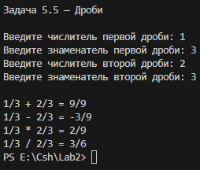

Корректный ввод (дроби 1/2 и 1/4):

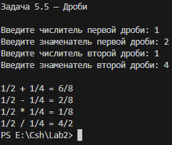

Некорректный ввод (знаменатель равен нулю — программа переспрашивает):

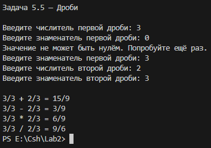

Некорректный ввод (не число — программа переспрашивает):

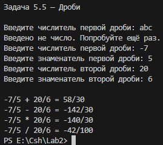

---

## Примечания
- Все задачи оформлены в одном проекте, классы — в отдельных файлах.
- В каждом классе присутствуют свойства, конструкторы и метод `ToString()`.
- Свойства — полные, без автосвойств.
- LINQ и лямбда-операторы не использованы.
- Модификатор `static` — только у `Main`.
- Ввод — с клавиатуры, с проверкой через класс `Validator` (методы `Read*UntilValid` —
повторяют ввод при ошибке).
- Изменения, вносимые задачами 4.5 и 3.4, закомментированы в коде согласно
требованию задания.
